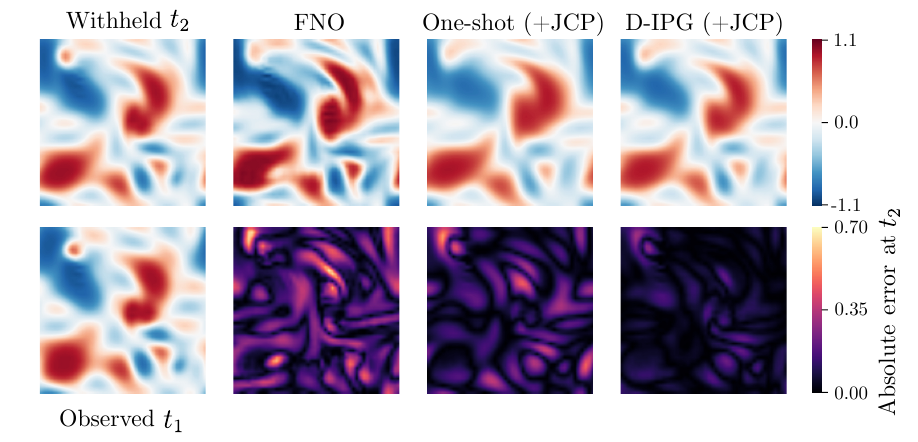
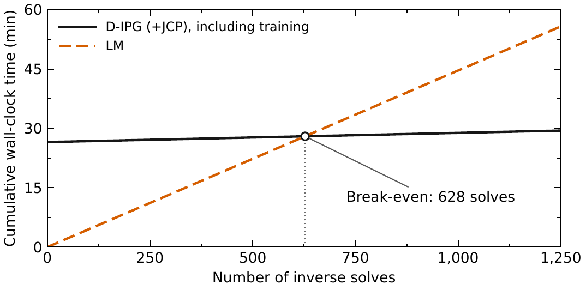

# Deceptron

Learn a reverse map once and reuse it to solve nonlinear inverse problems that share a forward model.

[](https://colab.research.google.com/github/AadityaKachhadiya/deceptron/blob/main/examples/quickstart.ipynb)

**Paper** · [*Local Inverse Geometry Can Be Amortized*](https://arxiv.org/abs/2605.13068)

## Installation

Requires Python 3.9 or later and PyTorch 2.0 or later.

```bash
python -m pip install git+https://github.com/AadityaKachhadiya/deceptron.git
```

## Quick start

Run D-IPG from any Python file. This example supplies an exact reverse
map for the measurement equation `y = 2x`:

```python
import torch
from deceptron import DIPG, DeceptronModule, SolverConfig
model = DeceptronModule(lambda x: 2 * x, lambda y: y / 2)
result = DIPG(model, torch.tensor([0.8]), torch.zeros(1), SolverConfig(tolerance_eps=1e-5))
print(result["x_hat"])  # approximately tensor([0.4000])
```

The [quick-start notebook](examples/quickstart.ipynb) also trains a
reverse map for a custom measurement equation and displays a pretrained
Heat-3D recovery inline. See [Training with your own data](docs/user_guide.md#training-with-your-own-data)
for the training API.

## Reproduce the paper

The [experiment guide](reproduce/README.md) lists the scripts, data
generation, and expected outputs for the seven PDE benchmarks. See
[Data](reproduce/data/README.md) for the held-out arrays and frozen
checkpoints. To run the complete Heat-3D benchmark from source:

```bash
git clone https://github.com/AadityaKachhadiya/deceptron.git
cd deceptron
python -m pip install -e ".[demo]" pandas scipy
python reproduce/experiments/heat3d.py
```

The script generates the data, trains the models, and writes
`runs/heat3d/heat3d_cnn_main_results.csv`. See the guide for GPU setup and
the [archived result](reproduce/results/heat3d_cnn_main_results.csv).
The guide also gives commands to [replay the Allen–Cahn and Navier–Stokes
comparisons](reproduce/README.md#checkpoint-replay) and [generate the
figures](reproduce/README.md#figures).

## Benchmark figures



**Navier–Stokes.** Recover the initial vorticity from one noisy snapshot
and compare the resulting flow with the withheld snapshot. [Run and data](reproduce/README.md#navierstokes-with-a-withheld-observation)



**Allen–Cahn.** Projected cumulative time at a common measurement
tolerance, including Deceptron training cost. [Run and timing protocol](reproduce/README.md#matched-target-allencahn-and-amortization)

## Citation

```bibtex
@misc{kachhadiya2026localinversegeometryamortized,
      title={Local Inverse Geometry Can Be Amortized},
      author={Aaditya L. Kachhadiya},
      year={2026},
      eprint={2605.13068},
      archivePrefix={arXiv},
      primaryClass={cs.LG},
      url={https://arxiv.org/abs/2605.13068},
}
```

## License

[MIT](LICENSE).
