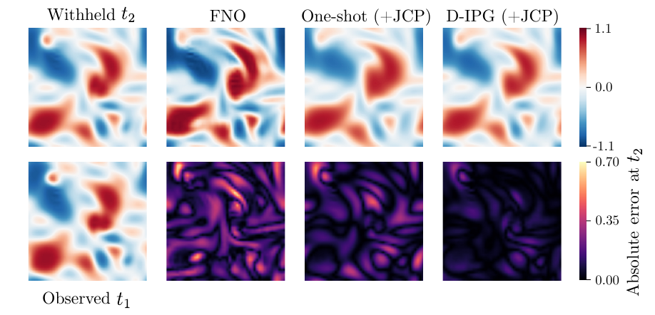

# Reproduce the paper

## PDE inverse problems

Each Python script runs the original seed-7 benchmark from data generation
through evaluation. The notebooks contain the original research code,
including the extended plots and seed sweeps. The pooled performance
profiles and main diagnostics can be regenerated from the archived
traces using the [figure script](#figures).

| Problem | Recover from measurements | Python script | Original notebook | Archived results | Success threshold |
| --- | --- | --- | --- | --- | --- |
| Heat-1D | Initial temperature from a noisy final readout with mixing | [heat1d.py](experiments/heat1d.py) | [Notebook](notebooks/Heat1D.ipynb) | [CSV](results/heat1d_main_results.csv) | Normalized measurement RMSE ≤ 0.30 |
| Heat-2D | Initial temperature from a blurred, noisy final readout | [heat2d.py](experiments/heat2d.py) | [Notebook](notebooks/Heat2D.ipynb) | [CSV](results/heat2d_cnn_main_results.csv) | Normalized measurement RMSE ≤ 0.40 |
| Heat-3D | Initial temperature from a blurred, noisy final readout | [heat3d.py](experiments/heat3d.py) | [Notebook](notebooks/Heat3D.ipynb) | [CSV](results/heat3d_cnn_main_results.csv) | Normalized measurement RMSE ≤ 0.38 |
| Advection–diffusion | Initial scalar field from a blurred, downsampled, noisy final field | [advection_diffusion.py](experiments/advection_diffusion.py) | [Notebook](notebooks/Advection_diffusion.ipynb) | [CSV](results/advdiff_degraded_main_results.csv) | State RMSE ≤ 0.10 |
| Allen–Cahn | Initial phase field from a noisy later phase field | [allen_cahn.py](experiments/allen_cahn.py) | [Notebook](notebooks/AllenCahn2D.ipynb) | [CSV](results/allen_cahn2d_main_results.csv) | State RMSE ≤ 0.10 |
| Darcy | Permeability from four noisy pressure fields under distinct sources | [darcy.py](experiments/darcy.py) | [Notebook](notebooks/Darcy2D.ipynb) | [CSV](results/darcy_multisource_main_results.csv) | State RMSE ≤ 0.18 |
| Navier–Stokes | Initial vorticity from two noisy snapshots | [navier_stokes.py](experiments/navier_stokes.py) | [Notebook](notebooks/NavierStokes2D.ipynb) | [CSV](results/navier_stokes_main_results.csv) | State RMSE ≤ 0.12 |

The [matched-target Allen–Cahn comparison](#matched-target-allencahn-and-amortization)
and the [single-snapshot Navier–Stokes evaluation](#navierstokes-with-a-withheld-observation)
have separate protocols and archived outputs below.

## Run an experiment

From the repository root, install the package and benchmark dependencies:

```bash
python -m pip install -e ".[demo]" pandas scipy
```

Run the script for the problem you want. For example, to train and evaluate
both JCP variants on Heat-3D:

```bash
python reproduce/experiments/heat3d.py
```

Each script uses CUDA when available and defaults to writing results to
`runs/<script name>/`. Pass `--output-dir` with a new path for another run.
The output includes benchmark CSVs, training histories, and model
checkpoints. On Colab, use a GPU runtime, change into the cloned
repository with `%cd /content/deceptron`, and prefix the shell commands
above with `!`. The original timings were measured on an NVIDIA T4.
Fresh full-budget GPU runs of these scripts are pending verification.

For Heat-3D, compare `runs/heat3d/heat3d_cnn_main_results.csv` with the
[archived summary](results/heat3d_cnn_main_results.csv). The archived
D-IPG (+JCP) row reports 80 of 80 cases meeting the normalized
measurement RMSE threshold of 0.38 and a mean state RMSE of 0.063546.
Wall-clock times depend on the hardware and software environment.

## Data

The [data directory](data/README.md) provides the original held-out
arrays for all seven benchmarks as `.npz` files. The benchmark scripts
generate synthetic data with their PDE simulators.
Each script specifies the grid, PDE parameters, train/validation/test
sizes, observation degradation, and seed. The data generation code builds
the latent fields, generates the corresponding PDE observations, and
uses training statistics to normalize measurements. Running an experiment
regenerates its input data without a dataset download. The two-snapshot
Navier–Stokes script also saves the generated dataset as a PyTorch file
in the run directory.

## Checkpoint replay

With the dependencies installed, run these commands from the repository
root to evaluate the shipped frozen checkpoints on the archived test splits:

```bash
python reproduce/experiments/allen_cahn_matched.py
python reproduce/experiments/navier_stokes_withheld_t2.py
```

Both commands run on CPU and evaluate 80 cases. The Allen–Cahn replay
writes `runs/allen_cahn_matched/allen_cahn_matched_cpu_replay.csv`.
The Navier–Stokes replay simulates a PDE trajectory for each recovered
initial field. It writes `navier_stokes_withheld_t2_per_case.csv` and a
field comparison for case 52 under `runs/navier_stokes_withheld_t2/`.
Compare the outputs with the archived [Allen–Cahn scores](results/allen_cahn_matched_cpu_replay.csv)
and [Navier–Stokes scores](results/navier_stokes_withheld_t2_per_case.csv).
In a local CPU replay, the maximum absolute differences across recorded
RMSE values were below `5e-7` for both comparisons.

## Figures

```bash
python reproduce/experiments/figures_deceptron.py
```

This regenerates the solver profiles, Allen–Cahn basin analysis,
reliability matrix, and appendix diagnostics from the [saved traces and
ablation results](results/traces/) and the archived benchmark summaries.
Plots are saved to `runs/figures/`. The manuscript applies its own
typography and layout to the plotted results.

## Inspect archived results

From the repository root, run:

```bash
python reproduce/summarize_results.py
```

This reads the archived CSVs and reports the seven benchmark summaries,
the matched-target Allen–Cahn reconstruction metrics and break-even
calculation, and the single-snapshot Navier–Stokes errors. It uses the
Python standard library and takes no training or GPU compute.

For the [pretrained Heat-3D example](../docs/user_guide.md#examples),
the model and held-out observation come from the original run. A CPU replay
with the archived checkpoint reproduced the original mean state RMSE
(0.063546), mean normalized measurement RMSE (0.290711), and 80/80 measurement
target hits. The quick start bundles one of the 80 cases.

## Matched-target Allen–Cahn and amortization

The [paired CPU replay](results/allen_cahn_matched_cpu_replay.csv)
uses seed 7, the archived +JCP checkpoint, zero initialization, and
LM damping of 0.0001, selected on 20 validation cases. The shared test
target is normalized measurement RMSE at most 0.12. Recovery success
uses state RMSE at most 0.10. Both methods hit the target in all 80
test cases. Mean state RMSE is 0.09399 for D-IPG and 0.14650 for LM.

The break-even calculation uses the original reported GPU timings
(0.1394 s and 2.6783 s per solve) and charges the full 1,592.89 s
training pipeline to D-IPG. This gives 628 whole solves. The original
comparison used a single NVIDIA T4, warmed up both solvers, alternated
their evaluation order, and synchronized the GPU before timing.
The attached CPU replay provides the paired reconstruction metrics.
The original per-case GPU timing log is still being located.

## Navier–Stokes with a withheld observation



The [saved protocol](results/ns_partial_observation_matched_protocol_seed7.csv)
specifies the frozen models, zero initialization, and observation mask
for all 80 paired cases. The observed input is the noisy vorticity at
the first time. The second snapshot is withheld during inversion.
The same PDE solver advances each recovered initial state to the
withheld time.

The [per-case rollout scores](results/navier_stokes_withheld_t2_per_case.csv)
include both state RMSE and withheld-time RMSE. The summary command
recomputes the four reported means and includes the −JCP variant.
The figure above is exported from the manuscript. The
[checkpoint replay](#checkpoint-replay) recomputes the recovered fields
and the withheld-time comparisons using the archived test arrays.
